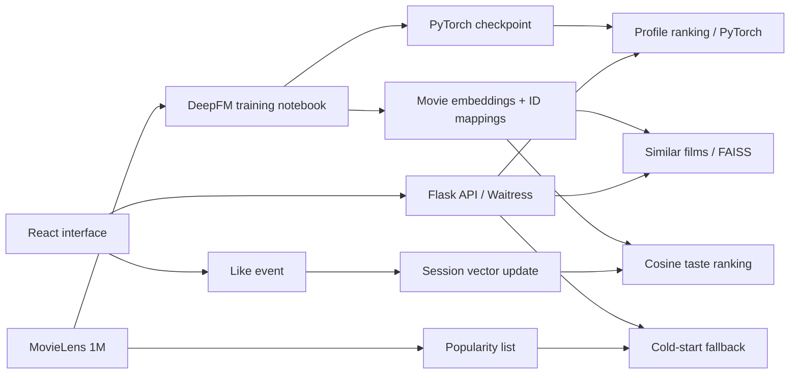

# Movie Recommendation System

A movie discovery application connecting an offline **DeepFM training pipeline** to **real model inference**, **FAISS similarity search**, and an **online session taste vector**. Built with PyTorch, Flask and React on MovieLens 1M.

[Model card](docs/MODEL_CARD.md) · [API](docs/API.md) · [2-minute demo](docs/DEMO.md) · [Hướng dẫn tiếng Việt](docs/SETUP.vi.md)

## What you can try

- **Discover immediately:** popular favorites appear without filling in a form.
- **Rank by profile:** gender, age group and occupation feed the trained DeepFM model. Any unknown field routes to popularity fallback.
- **Explore similar films:** FAISS searches L2-normalized, 16-dimensional movie embeddings using inner product, equivalent to cosine similarity.
- **Shape a session taste:** likes update a user vector with weighted logistic-gradient steps; Lantern ranks movies by cosine similarity once the signal passes the fallback threshold.
- **Use the complete demo:** a dark cinema-style layout, featured movie backdrops, horizontal poster rails, optional TMDB artwork, loading/error/retry states, and keyboard-accessible tabs and dialog. Browser sessions have separate demo identifiers.

This is a portfolio/research demo, with real inference and in-memory sessions. No hosted demo is configured in this repository.

## ML evidence

| Item | Evidence |
| --- | --- |
| Dataset files | 6,040 users · 3,883 movies · 1,000,209 ratings |
| Checked-in model | 85,516 parameters; item embeddings: 3,883 × 16 |
| Artifact consistency | Retrieval embeddings match checkpoint weights exactly; mappings form a bijection |
| Saved notebook test results | ROC-AUC **0.7841** · log loss **0.4156** · accuracy **0.8094** |

Metrics are outputs saved in [Deep_FM_Pytorch.ipynb](Data/Deep_FM_Pytorch.ipynb), **not a fresh evaluation**. The notebook uses row-level random splits of sampled interactions, not a temporal or unseen-user benchmark. These classification metrics do not establish top-K recommendation quality or production impact. See the [model card](docs/MODEL_CARD.md) for sampling and evaluation caveats.

Artifact checks are independently reproducible with `python scripts/check_artifacts.py`; file hashes and shapes are recorded in [docs/artifacts.json](docs/artifacts.json).

## Architecture



The offline model remains fixed during the demo. Lantern updates only the session user vector; it does not retrain DeepFM on every click.

## Run locally

Prerequisites: **Python 3.11–3.12**, **Node.js 22 with npm**. Model weights and embeddings are already included; no training or GPU is required.

```powershell
# From the repository root (Windows PowerShell)
python -m venv .venv
.\.venv\Scripts\python.exe -m pip install -r src-backend/requirements.txt
.\.venv\Scripts\python.exe scripts/download_dataset.py
cd src-frontend
npm ci
cd ..
.\start.ps1
```

Open **http://localhost:3000**. API health: **http://localhost:5000/health**. Stop with Ctrl+C. Backend logs from the launcher are in `.logs/`.

On macOS/Linux, create and activate `.venv`, install the same requirements, then run `python src-backend/run.py` and `cd src-frontend && npm start` in separate terminals. For a smaller Linux install, install `torch==2.7.0` from the [official CPU wheel index](https://download.pytorch.org/whl/cpu) before the remaining requirements.

Optional posters: copy [src-frontend/.env.example](src-frontend/.env.example) to `src-frontend/.env.local`, set `REACT_APP_TMDB_API_KEY`, and restart React. Poster/backdrop requests are cached, have a timeout and do not delay recommendation rendering. Keys prefixed with `REACT_APP_` are visible to the browser. Without a key or on image failure, an explicit artwork-unavailable placeholder is shown; no synthetic movie posters are used.

## Validate

```powershell
.\.venv\Scripts\python.exe scripts/check_artifacts.py
.\.venv\Scripts\python.exe -m unittest discover -s src-backend -p "test_*.py" -v
cd src-frontend
npm test -- --watchAll=false --runInBand
npm run build
```

[GitHub Actions](.github/workflows/ci.yml) runs frontend interaction tests/build and backend real-model integration tests/artifact checks on pushes and pull requests. See the repository's Actions tab for hosted results.

## Repository map

| Path | Purpose |
| --- | --- |
| `Data/Deep_FM_Pytorch.ipynb` | Data processing, sampling, training, evaluation and model export |
| `Data/artifacts/` | Active checkpoint, embeddings, ID maps and popularity list |
| `src-backend/predict_torch.py` | Cached model loading and full-catalog profile scoring |
| `src-backend/similar.py` | FAISS retrieval, user-vector updates and taste summaries |
| `src-frontend/src/` | React discovery interface, API client and interaction tests |
| `scripts/` | Artifact validation and official dataset download |
| `Data/LogisticRegression.ipynb`, `Data/Wide&Deep.ipynb` | Earlier experiments; not the serving path |

`Data/deepfm_model`, `predict_tf_backup.py` and `export_item_embeddings.py` are historical artifacts. Use the runtime requirements and npm lockfile above. Obsolete machine-specific environment dumps are excluded from the current source tree.

## Scope and attribution

Taste is held in process memory, so restarting the API clears it. Session IDs separate browser tabs but are not authentication. There is no database, multi-worker session sharing, load benchmark, deployment SLA, or measured engagement uplift. The MovieLens catalog is historical; demographic inputs use the original dataset's limited categories. Windows retains the original OpenMP compatibility workaround; see setup notes before production use.

Dataset: [MovieLens 1M, GroupLens Research](https://grouplens.org/datasets/movielens/1m/). Citation: F. Maxwell Harper and Joseph A. Konstan, *The MovieLens Datasets: History and Context*, ACM TiiS, 2015, [doi:10.1145/2827872](https://doi.org/10.1145/2827872). Dataset use and redistribution remain subject to the [original terms](https://files.grouplens.org/datasets/movielens/ml-1m-README.txt); no GroupLens endorsement is implied. Optional poster images are served by TMDB and are not bundled. See [data notes](docs/DATA.md) before redistributing dataset files.
